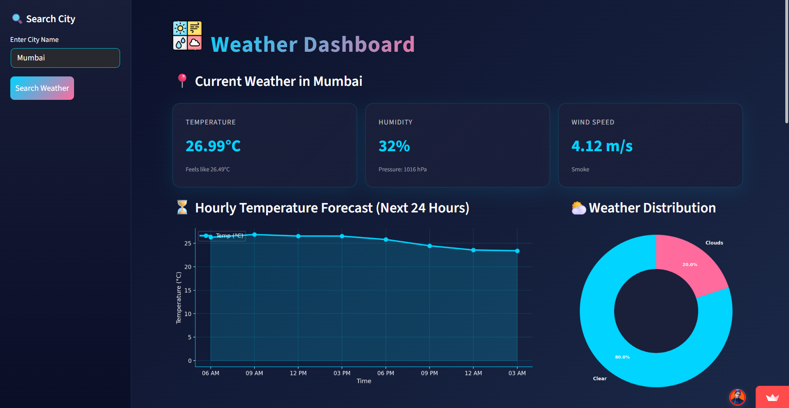

# 🌦️ Advanced Weather Dashboard — PRO Version

<p align="center">
  
  
  
  
</p>

<p align="center">
  
</p>

<p align="center">
  <a href="https://weather-dashboard149.streamlit.app/"><b>🚀 Live Demo on Streamlit Cloud</b></a>
</p>

## 🌐 Project Overview

A real-time weather analytics dashboard built with **Streamlit** and the **OpenWeatherMap API**. Search any city to see current conditions, a 5-day forecast, a 24-hour trend, and analytics charts in a clean card-based UI.

## ⭐ Features

### 🔍 Real-Time Weather Lookup
- Temperature (°C) and "feels like"
- Humidity, wind speed and pressure
- Weather condition with emoji

### 📅 5-Day Forecast
- Min/Max line charts
- Daily summaries
- CSV export

### 🕒 Hourly Forecast
- Area chart for the next 24 hours

### 📊 Analytics Charts (Matplotlib + Seaborn)

| Chart | Purpose |
| --- | --- |
| 📈 Area Chart | Hourly temperature trend |
| 🍩 Donut Chart | Weather condition share |
| 📉 Line Chart | Min/Max forecast graph |
| 📊 Bar Charts | Humidity & wind comparison |
| 🔥 Heatmap | Temperature–humidity–wind correlation |

### 🎨 Premium UI
- Custom CSS styling and card-based layout
- Dark theme with emoji-enhanced UI

## 🧰 Tech Stack

| Technology | Purpose |
| --- | --- |
| Python | Core backend |
| Streamlit | Frontend UI |
| OpenWeatherMap API | Weather data |
| Pandas | Data handling |
| NumPy | Numerical operations |
| Matplotlib | Graphs |
| Seaborn | Analytics visuals |

## 📂 Folder Structure

```txt
weather-Dashboard/
├── app.py
├── requirements.txt
├── README.md
├── .streamlit/
│   └── secrets.toml.example
└── Assets/
    ├── Banner.png
    └── meteorology.png
```

## 🔧 Installation & Setup

1. **Clone the repo**
   ```bash
   git clone https://github.com/Aniketgupta149/weather-Dashboard.git
   cd weather-Dashboard
   ```

2. **Install packages**
   ```bash
   pip install -r requirements.txt
   ```

3. **Add your API key**

   Get a free key from [OpenWeatherMap](https://openweathermap.org/api), copy `.streamlit/secrets.toml.example` to `.streamlit/secrets.toml`, and paste your key:
   ```toml
   OPENWEATHER_API_KEY = "your-api-key-here"
   ```
   You can also set `OPENWEATHER_API_KEY` as an environment variable.

4. **Run the app**
   ```bash
   streamlit run app.py
   ```
   The app opens at `http://localhost:8501`.

## 🌐 Deploy on Streamlit Cloud

<a href="https://share.streamlit.io/"></a>

1. Push the code to GitHub
2. Go to [share.streamlit.io](https://share.streamlit.io) and click **New app**
3. Select the repo → branch → `app.py`
4. Under **Advanced settings → Secrets**, add `OPENWEATHER_API_KEY = "your-key"`
5. Deploy ✔

## 💡 Future Enhancements

- 🌍 Multi-city comparison *(available in [Meteorology-Analytics-Pro](https://github.com/Aniketgupta149/Meteorology-Analytics-Pro))*
- 🛰️ Satellite weather layer
- 🗺️ Interactive map (Folium / Mapbox)
- 🫙 Local data caching

## 🧑‍💻 Author

**Aniket Gupta**
- 🌐 [Portfolio](https://aniket-portfolio149.web.app)
- 🐙 [GitHub](https://github.com/Aniketgupta149)
- 🔗 [LinkedIn](https://www.linkedin.com/in/aniket-gupta-b44611261)

## ⭐ Support

If you liked this project, give the repo a star ⭐. It motivates continued development 😊
